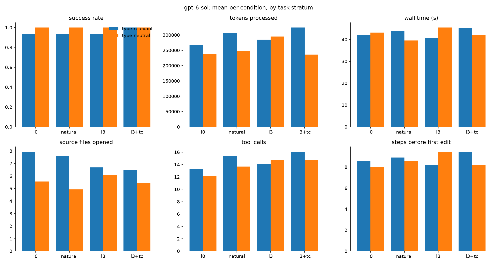

# Results: codex

128 finished runs, 16 tasks, conditions: l0, natural, l3, l3+tc

## Comparisons (declared in DESIGN.md before running)

Each cell: paired-by-task estimate [95% bootstrap interval], sign-flip p-value, and in brackets the p-value Holm-adjusted across the metrics of that comparison (DESIGN.md section 9). Success rate and score are differences in proportion (+0.10 = 10 points better); the other metrics are ratios (x0.80 = 20% less).

| metric | C1: l3 vs l0 | C1-control: l3 vs l0 | C2: l3+tc vs l3 | C3: l3 vs natural |
|---|---|---|---|---|
| success rate | +0.00 [+0.00, +0.00] p=1.000 (Holm 1.000) | +0.00 [+0.00, +0.00] p=1.000 (Holm 1.000) | +0.05 [+0.00, +0.15] p=1.000 (Holm 1.000) | +0.00 [+0.00, +0.00] p=1.000 (Holm 1.000) |
| score (partial credit) | +0.00 [+0.00, +0.00] p=1.000 (Holm 1.000) | +0.00 [+0.00, +0.00] p=1.000 (Holm 1.000) | +0.01 [+0.00, +0.04] p=1.000 (Holm 1.000) | +0.00 [+0.00, +0.00] p=1.000 (Holm 1.000) |
| wall time (s) | x0.97 [0.87, 1.08] p=0.541 (Holm 1.000) | x1.04 [0.96, 1.12] p=0.401 (Holm 1.000) | x0.99 [0.89, 1.11] p=0.832 (Holm 1.000) | x0.99 [0.83, 1.19] p=0.946 (Holm 1.000) |
| tokens processed | x1.05 [0.96, 1.16] p=0.370 (Holm 1.000) | x1.21 [1.04, 1.42] p=0.089 (Holm 1.000) | x0.90 [0.78, 1.04] p=0.192 (Holm 1.000) | x0.97 [0.79, 1.19] p=0.805 (Holm 1.000) |
| tokens without cache reads | x1.26 [1.02, 1.58] p=0.128 (Holm 1.000) | x1.03 [0.89, 1.21] p=0.751 (Holm 1.000) | x1.03 [0.94, 1.13] p=0.561 (Holm 1.000) | x1.00 [0.80, 1.29] p=1.000 (Holm 1.000) |
| API-equivalent cost ($) | n/a | n/a | n/a | n/a |
| model turns | x1.06 [0.93, 1.20] p=0.440 (Holm 1.000) | x1.19 [1.04, 1.38] p=0.058 (Holm 0.817) | x1.01 [0.92, 1.12] p=0.897 (Holm 1.000) | x0.93 [0.76, 1.15] p=0.533 (Holm 1.000) |
| tool calls | x1.07 [0.92, 1.23] p=0.447 (Holm 1.000) | x1.22 [1.03, 1.43] p=0.066 (Holm 0.860) | x1.03 [0.94, 1.15] p=0.571 (Holm 1.000) | x0.91 [0.73, 1.18] p=0.518 (Holm 1.000) |
| source files opened | x0.93 [0.73, 1.11] p=0.751 (Holm 1.000) | x1.09 [1.00, 1.20] p=0.160 (Holm 1.000) | x1.00 [0.88, 1.14] p=0.975 (Holm 1.000) | x0.98 [0.78, 1.18] p=0.953 (Holm 1.000) |
| characters read from files | x1.13 [0.82, 1.50] p=0.486 (Holm 1.000) | x1.53 [1.19, 2.03] p=0.019 (Holm 0.292) | x0.81 [0.61, 1.07] p=0.192 (Holm 1.000) | x0.91 [0.61, 1.24] p=0.720 (Holm 1.000) |
| searches (grep/glob/ls) | x0.91 [0.68, 1.23] p=0.595 (Holm 1.000) | x0.94 [0.73, 1.24] p=0.782 (Holm 1.000) | x1.14 [0.85, 1.51] p=0.422 (Holm 1.000) | x0.82 [0.62, 1.04] p=0.253 (Holm 1.000) |
| edit actions | x1.10 [0.73, 1.62] p=0.758 (Holm 1.000) | x1.43 [1.18, 1.74] p=0.152 (Holm 1.000) | x0.85 [0.66, 1.14] p=0.321 (Holm 1.000) | x1.10 [0.72, 1.62] p=0.758 (Holm 1.000) |
| test runs | +0.06 [-0.25, +0.38] p=1.000 (Holm 1.000) | +0.25 [-0.31, +0.88] p=0.626 (Holm 1.000) | -0.20 [-0.85, +0.60] p=0.713 (Holm 1.000) | -0.19 [-0.62, +0.19] p=0.689 (Holm 1.000) |
| type-checker runs | +0.00 [+0.00, +0.00] p=1.000 (Holm 1.000) | +0.00 [+0.00, +0.00] p=1.000 (Holm 1.000) | +1.50 [+1.15, +1.95] p=0.003 (Holm 0.044) | +0.00 [+0.00, +0.00] p=1.000 (Holm 1.000) |
| linter runs | +0.00 [+0.00, +0.00] p=1.000 (Holm 1.000) | +0.00 [+0.00, +0.00] p=1.000 (Holm 1.000) | +0.00 [+0.00, +0.00] p=1.000 (Holm 1.000) | +0.00 [+0.00, +0.00] p=1.000 (Holm 1.000) |
| steps before first edit | x0.97 [0.74, 1.26] p=0.818 (Holm 1.000) | x1.21 [1.08, 1.36] p=0.152 (Holm 1.000) | x0.98 [0.87, 1.13] p=0.783 (Holm 1.000) | x0.84 [0.66, 1.07] p=0.394 (Holm 1.000) |

- **C1**: Do types help? (where they should) (l3 vs l0; tasks: `stratum == 'type_relevant'`)
- **C1-control**: Do types help? (where they shouldn't: control) (l3 vs l0; tasks: `stratum == 'type_neutral'`)
- **C2**: Does a type checker help on top of types? (code changes) (l3+tc vs l3; tasks: `category in ['bugfix', 'change']`)
- **C3**: Types vs well-named untyped code (l3 vs natural; tasks: `stratum == 'type_relevant'`)

## Per condition (success: mean; costs: median)

| condition   |   runs |   passed |   score |   wall_s |   total_tokens |   uncached_tokens |   cost_usd |   turns |   tool_calls |   unique_files_read |   read_chars |   searches |   edits |   test_runs |   typecheck_runs |   lint_runs |   steps_before_first_edit |
|:------------|-------:|---------:|--------:|---------:|---------------:|------------------:|-----------:|--------:|-------------:|--------------------:|-------------:|-----------:|--------:|------------:|-----------------:|------------:|--------------------------:|
| l0          |     32 |    0.969 |   0.992 |    40.2  |         250561 |           25006.5 |        nan |    15.5 |         12.5 |                   6 |      30676.5 |          2 |       1 |       1.062 |            0     |           0 |                         7 |
| natural     |     32 |    0.969 |   0.992 |    37.65 |         262072 |           25650.5 |        nan |    18   |         14   |                   6 |      34289   |          2 |       1 |       1.188 |            0     |           0 |                         8 |
| l3          |     32 |    0.969 |   0.992 |    38.85 |         277896 |           26243.5 |        nan |    18   |         14.5 |                   6 |      43233.5 |          2 |       2 |       1.219 |            0     |           0 |                         8 |
| l3+tc       |     32 |    1     |   1     |    40.3  |         244190 |           30312   |        nan |    17.5 |         14   |                   6 |      36522.5 |          2 |       1 |       1.094 |            0.938 |           0 |                         8 |

## Success rate by stratum and category

|                               |   l0 |   natural |   l3 |   l3+tc |
|:------------------------------|-----:|----------:|-----:|--------:|
| ('type_neutral', 'question')  |  1   |       1   |  1   |       1 |
| ('type_neutral', 'list')      |  1   |       1   |  1   |       1 |
| ('type_neutral', 'bugfix')    |  1   |       1   |  1   |       1 |
| ('type_neutral', 'change')    |  1   |       1   |  1   |       1 |
| ('type_relevant', 'question') |  1   |       1   |  1   |       1 |
| ('type_relevant', 'list')     |  1   |       1   |  1   |       1 |
| ('type_relevant', 'bugfix')   |  1   |       1   |  1   |       1 |
| ('type_relevant', 'change')   |  0.5 |       0.5 |  0.5 |       1 |

## Success rate by task

|                                              |   l0 |   natural |   l3 |   l3+tc |
|:---------------------------------------------|-----:|----------:|-----:|--------:|
| ('type_neutral', 'c2_dunning')               |  1   |       1   |  1   |       1 |
| ('type_neutral', 'f1_partial_refunds')       |  1   |       1   |  1   |       1 |
| ('type_neutral', 'm3_net_terms')             |  1   |       1   |  1   |       1 |
| ('type_neutral', 'mut25_dunning_bool_swap')  |  1   |       1   |  1   |       1 |
| ('type_neutral', 'mut46_reports_arith_swap') |  1   |       1   |  1   |       1 |
| ('type_neutral', 'n1_webhook_backoff')       |  1   |       1   |  1   |       1 |
| ('type_neutral', 'n4_extend_trial')          |  1   |       1   |  1   |       1 |
| ('type_neutral', 'n5_updated_emitters')      |  1   |       1   |  1   |       1 |
| ('type_relevant', 'b1_refund_fails')         |  1   |       1   |  1   |       1 |
| ('type_relevant', 'b2_usage_not_billed')     |  1   |       1   |  1   |       1 |
| ('type_relevant', 'b3_no_card_dunning')      |  1   |       1   |  1   |       1 |
| ('type_relevant', 'b5_no_retries')           |  1   |       1   |  1   |       1 |
| ('type_relevant', 'c3_usage_window')         |  1   |       1   |  1   |       1 |
| ('type_relevant', 'i1_usage_seconds_impact') |  1   |       1   |  1   |       1 |
| ('type_relevant', 'i3_optional_returns')     |  1   |       1   |  1   |       1 |
| ('type_relevant', 'm2_usage_seconds')        |  0.5 |       0.5 |  0.5 |       1 |

## Median tokens by task

|                                              |     l0 |   natural |     l3 |   l3+tc |
|:---------------------------------------------|-------:|----------:|-------:|--------:|
| ('type_neutral', 'c2_dunning')               | 128198 |    126828 | 127902 |  137270 |
| ('type_neutral', 'f1_partial_refunds')       | 357488 |    495420 | 466452 |  407918 |
| ('type_neutral', 'm3_net_terms')             | 421990 |    321934 | 405216 |  327764 |
| ('type_neutral', 'mut25_dunning_bool_swap')  | 254362 |    278074 | 235988 |  198343 |
| ('type_neutral', 'mut46_reports_arith_swap') | 220188 |    175390 | 342814 |  211188 |
| ('type_neutral', 'n1_webhook_backoff')       | 117593 |    111008 | 116608 |  111402 |
| ('type_neutral', 'n4_extend_trial')          | 253722 |    301912 | 471958 |  323570 |
| ('type_neutral', 'n5_updated_emitters')      | 149344 |    166813 | 192446 |  170204 |
| ('type_relevant', 'b1_refund_fails')         | 229782 |    258694 | 248961 |  198626 |
| ('type_relevant', 'b2_usage_not_billed')     | 316264 |    261834 | 351701 |  332095 |
| ('type_relevant', 'b3_no_card_dunning')      | 309159 |    355839 | 282659 |  318244 |
| ('type_relevant', 'b5_no_retries')           | 252650 |    279644 | 285992 |  347960 |
| ('type_relevant', 'c3_usage_window')         | 164104 |    175690 | 144594 |  150712 |
| ('type_relevant', 'i1_usage_seconds_impact') | 169791 |    148767 | 233754 |  246320 |
| ('type_relevant', 'i3_optional_returns')     | 296187 |    480413 | 266233 |  333652 |
| ('type_relevant', 'm2_usage_seconds')        | 403708 |    488054 | 465155 |  667556 |

## Charts

