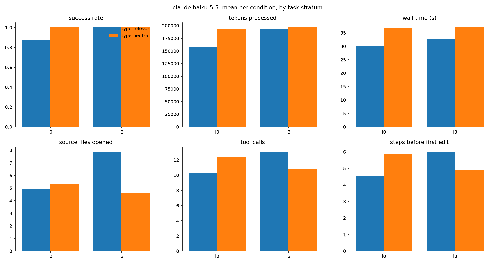

# Results: haiku

96 finished runs, 16 tasks, conditions: l0, l3

## Comparisons (declared in DESIGN.md before running)

Each cell: paired-by-task estimate [95% bootstrap interval], sign-flip p-value, and in brackets the p-value Holm-adjusted across the metrics of that comparison (DESIGN.md section 9). Success rate and score are differences in proportion (+0.10 = 10 points better); the other metrics are ratios (x0.80 = 20% less).

| metric | C1: l3 vs l0 | C1-control: l3 vs l0 | C2: l3+tc vs l3 | C3: l3 vs natural |
|---|---|---|---|---|
| success rate | +0.12 [+0.00, +0.38] p=1.000 (Holm 1.000) | +0.00 [+0.00, +0.00] p=1.000 (Holm 1.000) | n/a | n/a |
| score (partial credit) | +0.03 [+0.00, +0.09] p=1.000 (Holm 1.000) | +0.00 [+0.00, +0.00] p=1.000 (Holm 1.000) | n/a | n/a |
| wall time (s) | x1.08 [1.03, 1.13] p=0.019 (Holm 0.272) | x0.98 [0.90, 1.07] p=0.712 (Holm 1.000) | n/a | n/a |
| tokens processed | x1.21 [1.11, 1.31] p=0.019 (Holm 0.272) | x0.97 [0.86, 1.08] p=0.696 (Holm 1.000) | n/a | n/a |
| tokens without cache reads | x1.04 [0.99, 1.10] p=0.315 (Holm 1.000) | x0.96 [0.85, 1.07] p=0.556 (Holm 1.000) | n/a | n/a |
| API-equivalent cost ($) | x1.12 [1.08, 1.16] p=0.012 (Holm 0.187) | x1.00 [0.91, 1.09] p=0.930 (Holm 1.000) | n/a | n/a |
| model turns | x1.20 [0.99, 1.55] p=0.160 (Holm 1.000) | x0.87 [0.79, 0.98] p=0.082 (Holm 1.000) | n/a | n/a |
| tool calls | x1.22 [0.99, 1.61] p=0.160 (Holm 1.000) | x0.86 [0.77, 0.98] p=0.082 (Holm 1.000) | n/a | n/a |
| source files opened | x1.12 [0.96, 1.29] p=0.198 (Holm 1.000) | x0.87 [0.73, 1.05] p=0.160 (Holm 1.000) | n/a | n/a |
| characters read from files | x1.29 [1.12, 1.54] p=0.012 (Holm 0.187) | x1.12 [0.99, 1.26] p=0.144 (Holm 1.000) | n/a | n/a |
| searches (grep/glob/ls) | x0.77 [0.47, 1.26] p=0.529 (Holm 1.000) | x1.23 [0.98, 1.62] p=0.394 (Holm 1.000) | n/a | n/a |
| edit actions | x1.26 [1.02, 1.54] p=0.200 (Holm 1.000) | x0.99 [0.83, 1.20] p=0.938 (Holm 1.000) | n/a | n/a |
| test runs | +0.50 [+0.17, +0.88] p=0.066 (Holm 0.794) | -0.08 [-0.50, +0.25] p=1.000 (Holm 1.000) | n/a | n/a |
| type-checker runs | +0.00 [+0.00, +0.00] p=1.000 (Holm 1.000) | +0.04 [+0.00, +0.12] p=1.000 (Holm 1.000) | n/a | n/a |
| linter runs | +0.00 [+0.00, +0.00] p=1.000 (Holm 1.000) | +0.00 [+0.00, +0.00] p=1.000 (Holm 1.000) | n/a | n/a |
| steps before first edit | x1.66 [0.85, 5.38] p=0.723 (Holm 1.000) | x0.84 [0.64, 1.09] p=0.354 (Holm 1.000) | n/a | n/a |

- **C1**: Do types help? (where they should) (l3 vs l0; tasks: `stratum == 'type_relevant'`)
- **C1-control**: Do types help? (where they shouldn't: control) (l3 vs l0; tasks: `stratum == 'type_neutral'`)
- **C2**: Does a type checker help on top of types? (code changes) (l3+tc vs l3; tasks: `category in ['bugfix', 'change']`)
- **C3**: Types vs well-named untyped code (l3 vs natural; tasks: `stratum == 'type_relevant'`)

## Per condition (success: mean; costs: median)

| condition   |   runs |   passed |   score |   wall_s |   total_tokens |   uncached_tokens |   cost_usd |   turns |   tool_calls |   unique_files_read |   read_chars |   searches |   edits |   test_runs |   typecheck_runs |   lint_runs |   steps_before_first_edit |
|:------------|-------:|---------:|--------:|---------:|---------------:|------------------:|-----------:|--------:|-------------:|--------------------:|-------------:|-----------:|--------:|------------:|-----------------:|------------:|--------------------------:|
| l0          |     48 |    0.938 |   0.984 |    30.3  |         154408 |            4296   |      0.007 |    11   |         10   |                   4 |      16933   |          1 |       2 |       1.5   |            0     |           0 |                         4 |
| l3          |     48 |    1     |   1     |    29.45 |         175054 |            4549.5 |      0.008 |    12.5 |         11.5 |                   5 |      20886.5 |          0 |       3 |       1.708 |            0.021 |           0 |                         5 |

## Success rate by stratum and category

|                               |   l0 |   l3 |
|:------------------------------|-----:|-----:|
| ('type_neutral', 'question')  |    1 |    1 |
| ('type_neutral', 'list')      |    1 |    1 |
| ('type_neutral', 'bugfix')    |    1 |    1 |
| ('type_neutral', 'change')    |    1 |    1 |
| ('type_relevant', 'question') |    1 |    1 |
| ('type_relevant', 'list')     |    1 |    1 |
| ('type_relevant', 'bugfix')   |    1 |    1 |
| ('type_relevant', 'change')   |    0 |    1 |

## Success rate by task

|                                              |   l0 |   l3 |
|:---------------------------------------------|-----:|-----:|
| ('type_neutral', 'c2_dunning')               |    1 |    1 |
| ('type_neutral', 'f1_partial_refunds')       |    1 |    1 |
| ('type_neutral', 'm3_net_terms')             |    1 |    1 |
| ('type_neutral', 'mut25_dunning_bool_swap')  |    1 |    1 |
| ('type_neutral', 'mut46_reports_arith_swap') |    1 |    1 |
| ('type_neutral', 'n1_webhook_backoff')       |    1 |    1 |
| ('type_neutral', 'n4_extend_trial')          |    1 |    1 |
| ('type_neutral', 'n5_updated_emitters')      |    1 |    1 |
| ('type_relevant', 'b1_refund_fails')         |    1 |    1 |
| ('type_relevant', 'b2_usage_not_billed')     |    1 |    1 |
| ('type_relevant', 'b3_no_card_dunning')      |    1 |    1 |
| ('type_relevant', 'b5_no_retries')           |    1 |    1 |
| ('type_relevant', 'c3_usage_window')         |    1 |    1 |
| ('type_relevant', 'i1_usage_seconds_impact') |    1 |    1 |
| ('type_relevant', 'i3_optional_returns')     |    1 |    1 |
| ('type_relevant', 'm2_usage_seconds')        |    0 |    1 |

## Median tokens by task

|                                              |     l0 |     l3 |
|:---------------------------------------------|-------:|-------:|
| ('type_neutral', 'c2_dunning')               | 149867 | 185483 |
| ('type_neutral', 'f1_partial_refunds')       | 395015 | 408579 |
| ('type_neutral', 'm3_net_terms')             | 257033 | 268451 |
| ('type_neutral', 'mut25_dunning_bool_swap')  | 219825 | 199755 |
| ('type_neutral', 'mut46_reports_arith_swap') | 139856 | 138367 |
| ('type_neutral', 'n1_webhook_backoff')       | 107886 |  84239 |
| ('type_neutral', 'n4_extend_trial')          | 145386 | 174321 |
| ('type_neutral', 'n5_updated_emitters')      |  86060 | 102269 |
| ('type_relevant', 'b1_refund_fails')         | 153595 | 154950 |
| ('type_relevant', 'b2_usage_not_billed')     | 215591 | 320624 |
| ('type_relevant', 'b3_no_card_dunning')      | 149762 | 175786 |
| ('type_relevant', 'b5_no_retries')           | 186762 | 166066 |
| ('type_relevant', 'c3_usage_window')         |  70724 |  80960 |
| ('type_relevant', 'i1_usage_seconds_impact') |  77247 | 100124 |
| ('type_relevant', 'i3_optional_returns')     | 156603 | 229240 |
| ('type_relevant', 'm2_usage_seconds')        | 194595 | 298107 |

## Charts

