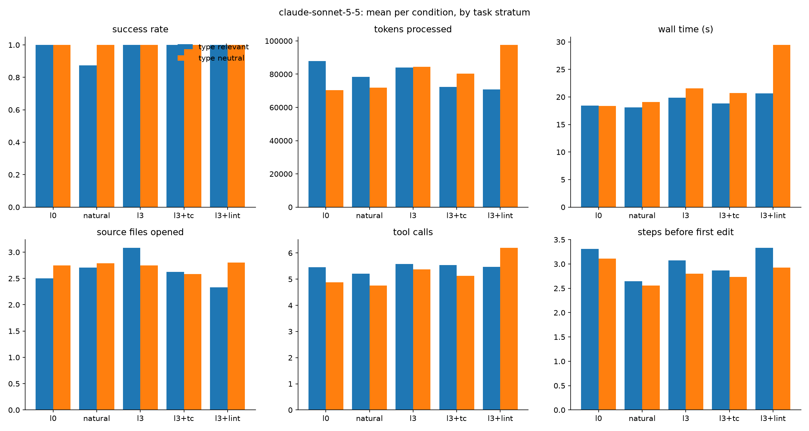

# Results: lint

222 finished runs, 16 tasks, conditions: l0, natural, l3, l3+tc, l3+lint

## Comparisons (declared in DESIGN.md before running)

Each cell: paired-by-task estimate [95% bootstrap interval], sign-flip p-value, and in brackets the p-value Holm-adjusted across the metrics of that comparison (DESIGN.md section 9). Success rate and score are differences in proportion (+0.10 = 10 points better); the other metrics are ratios (x0.80 = 20% less).

| metric | R2: l3+tc vs l3+lint | R2-lint: l3+lint vs l3 |
|---|---|---|
| success rate | +0.00 [+0.00, +0.00] p=1.000 (Holm 1.000) | +0.00 [+0.00, +0.00] p=1.000 (Holm 1.000) |
| score (partial credit) | +0.00 [+0.00, +0.00] p=1.000 (Holm 1.000) | +0.00 [+0.00, +0.00] p=1.000 (Holm 1.000) |
| wall time (s) | x0.90 [0.76, 1.07] p=0.278 (Holm 1.000) | x1.20 [1.02, 1.40] p=0.069 (Holm 0.970) |
| tokens processed | x0.99 [0.91, 1.09] p=0.840 (Holm 1.000) | x1.04 [0.94, 1.15] p=0.532 (Holm 1.000) |
| tokens without cache reads | x1.08 [0.98, 1.19] p=0.182 (Holm 1.000) | x0.96 [0.90, 1.02] p=0.223 (Holm 1.000) |
| API-equivalent cost ($) | x0.98 [0.93, 1.04] p=0.547 (Holm 1.000) | x1.01 [0.95, 1.08] p=0.836 (Holm 1.000) |
| model turns | x1.03 [0.91, 1.18] p=0.670 (Holm 1.000) | x1.02 [0.93, 1.11] p=0.750 (Holm 1.000) |
| tool calls | x1.03 [0.89, 1.22] p=0.690 (Holm 1.000) | x1.02 [0.92, 1.14] p=0.719 (Holm 1.000) |
| source files opened | x0.94 [0.83, 1.07] p=0.438 (Holm 1.000) | x0.94 [0.86, 1.03] p=0.251 (Holm 1.000) |
| characters read from files | x0.97 [0.92, 1.04] p=0.411 (Holm 1.000) | x0.92 [0.88, 0.98] p=0.026 (Holm 0.395) |
| searches (grep/glob/ls) | x1.00 [1.00, 1.00] p=1.000 (Holm 1.000) | x0.89 [0.50, 1.41] p=1.000 (Holm 1.000) |
| edit actions | x0.97 [0.81, 1.17] p=0.875 (Holm 1.000) | x1.02 [0.84, 1.19] p=0.875 (Holm 1.000) |
| test runs | +0.03 [-0.33, +0.43] p=1.000 (Holm 1.000) | +0.00 [-0.33, +0.27] p=1.000 (Holm 1.000) |
| type-checker runs | +1.37 [+0.97, +1.77] p=0.003 (Holm 0.047) | +0.00 [+0.00, +0.00] p=1.000 (Holm 1.000) |
| linter runs | -1.13 [-1.43, -0.80] p=0.005 (Holm 0.073) | +1.13 [+0.80, +1.43] p=0.005 (Holm 0.078) |
| steps before first edit | x0.94 [0.87, 1.01] p=0.253 (Holm 1.000) | x1.06 [0.97, 1.16] p=0.283 (Holm 1.000) |

- **R2**: Type checker against an advertised linter (code changes) (l3+tc vs l3+lint; tasks: `category in ['bugfix', 'change']`)
- **R2-lint**: Advertised linter against nothing (code changes) (l3+lint vs l3; tasks: `category in ['bugfix', 'change']`)

## Per condition (success: mean; costs: median)

| condition   |   runs |   passed |   score |   wall_s |   total_tokens |   uncached_tokens |   cost_usd |   turns |   tool_calls |   unique_files_read |   read_chars |   searches |   edits |   test_runs |   typecheck_runs |   lint_runs |   steps_before_first_edit |
|:------------|-------:|---------:|--------:|---------:|---------------:|------------------:|-----------:|--------:|-------------:|--------------------:|-------------:|-----------:|--------:|------------:|-----------------:|------------:|--------------------------:|
| l0          |     48 |    1     |   1     |    16.45 |        69684   |            1261.5 |      0.053 |     6   |          5   |                   3 |      10802.5 |          0 |       0 |       0.688 |            0     |       0     |                         3 |
| natural     |     48 |    0.938 |   0.969 |    15.4  |        67993   |            1265   |      0.056 |     6   |          5   |                   2 |      11374   |          0 |       0 |       0.667 |            0     |       0     |                         3 |
| l3          |     48 |    1     |   1     |    15.55 |        69616.5 |            1181   |      0.056 |     6.5 |          5.5 |                   3 |      11505.5 |          0 |       1 |       0.771 |            0     |       0     |                         3 |
| l3+tc       |     48 |    1     |   1     |    15.7  |        64853   |            1190   |      0.054 |     6   |          5   |                   2 |      10753.5 |          0 |       1 |       0.792 |            0.854 |       0     |                         3 |
| l3+lint     |     30 |    1     |   1     |    23.65 |        76712   |            1274.5 |      0.057 |     7   |          6   |                   2 |       9956   |          0 |       2 |       1.233 |            0     |       1.133 |                         3 |

## Success rate by stratum and category

|                               |   l0 |   natural |   l3 |   l3+tc |   l3+lint |
|:------------------------------|-----:|----------:|-----:|--------:|----------:|
| ('type_neutral', 'question')  |    1 |      1    |    1 |       1 |       nan |
| ('type_neutral', 'list')      |    1 |      1    |    1 |       1 |       nan |
| ('type_neutral', 'bugfix')    |    1 |      1    |    1 |       1 |         1 |
| ('type_neutral', 'change')    |    1 |      1    |    1 |       1 |         1 |
| ('type_relevant', 'question') |    1 |      1    |    1 |       1 |       nan |
| ('type_relevant', 'list')     |    1 |      1    |    1 |       1 |       nan |
| ('type_relevant', 'bugfix')   |    1 |      0.92 |    1 |       1 |         1 |
| ('type_relevant', 'change')   |    1 |      0.33 |    1 |       1 |         1 |

## Success rate by task

|                                              |   l0 |   natural |   l3 |   l3+tc |   l3+lint |
|:---------------------------------------------|-----:|----------:|-----:|--------:|----------:|
| ('type_neutral', 'c2_dunning')               |    1 |      1    |    1 |       1 |       nan |
| ('type_neutral', 'f1_partial_refunds')       |    1 |      1    |    1 |       1 |         1 |
| ('type_neutral', 'm3_net_terms')             |    1 |      1    |    1 |       1 |         1 |
| ('type_neutral', 'mut25_dunning_bool_swap')  |    1 |      1    |    1 |       1 |         1 |
| ('type_neutral', 'mut46_reports_arith_swap') |    1 |      1    |    1 |       1 |         1 |
| ('type_neutral', 'n1_webhook_backoff')       |    1 |      1    |    1 |       1 |       nan |
| ('type_neutral', 'n4_extend_trial')          |    1 |      1    |    1 |       1 |         1 |
| ('type_neutral', 'n5_updated_emitters')      |    1 |      1    |    1 |       1 |       nan |
| ('type_relevant', 'b1_refund_fails')         |    1 |      1    |    1 |       1 |         1 |
| ('type_relevant', 'b2_usage_not_billed')     |    1 |      1    |    1 |       1 |         1 |
| ('type_relevant', 'b3_no_card_dunning')      |    1 |      0.67 |    1 |       1 |         1 |
| ('type_relevant', 'b5_no_retries')           |    1 |      1    |    1 |       1 |         1 |
| ('type_relevant', 'c3_usage_window')         |    1 |      1    |    1 |       1 |       nan |
| ('type_relevant', 'i1_usage_seconds_impact') |    1 |      1    |    1 |       1 |       nan |
| ('type_relevant', 'i3_optional_returns')     |    1 |      1    |    1 |       1 |       nan |
| ('type_relevant', 'm2_usage_seconds')        |    1 |      0.33 |    1 |       1 |         1 |

## Median tokens by task

|                                              |     l0 |   natural |     l3 |   l3+tc |   l3+lint |
|:---------------------------------------------|-------:|----------:|-------:|--------:|----------:|
| ('type_neutral', 'c2_dunning')               |  75541 |     62757 |  79442 |   72707 |       nan |
| ('type_neutral', 'f1_partial_refunds')       | 114938 |    126330 | 165913 |  190849 |    161568 |
| ('type_neutral', 'm3_net_terms')             |  75867 |     68366 | 100976 |   83121 |    102013 |
| ('type_neutral', 'mut25_dunning_bool_swap')  |  56461 |     59080 |  69658 |   70048 |     66054 |
| ('type_neutral', 'mut46_reports_arith_swap') |  53558 |     49391 |  42688 |   55378 |     66164 |
| ('type_neutral', 'n1_webhook_backoff')       |  55794 |     58101 |  49931 |   45140 |       nan |
| ('type_neutral', 'n4_extend_trial')          |  67605 |     56157 |  55871 |   55424 |     75240 |
| ('type_neutral', 'n5_updated_emitters')      |  69580 |     74203 |  71699 |   59954 |       nan |
| ('type_relevant', 'b1_refund_fails')         |  67866 |     70910 |  65082 |   56241 |     61776 |
| ('type_relevant', 'b2_usage_not_billed')     | 103944 |     74819 |  75995 |   63487 |     76465 |
| ('type_relevant', 'b3_no_card_dunning')      |  45461 |     78966 |  57049 |   58467 |     54505 |
| ('type_relevant', 'b5_no_retries')           |  78457 |     68213 |  69575 |   79728 |     79409 |
| ('type_relevant', 'c3_usage_window')         |  61175 |     46959 |  64791 |   61329 |       nan |
| ('type_relevant', 'i1_usage_seconds_impact') |  60047 |     71979 |  62197 |   62171 |       nan |
| ('type_relevant', 'i3_optional_returns')     | 212298 |    103312 | 149058 |   66887 |       nan |
| ('type_relevant', 'm2_usage_seconds')        |  75703 |     67070 | 104252 |  111158 |     82625 |

## Charts

