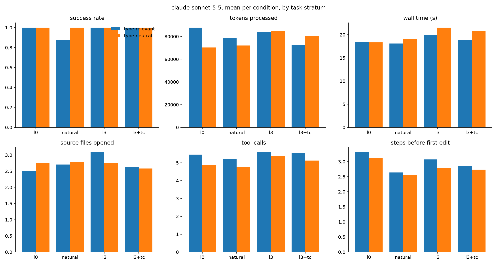

# Results: main

192 finished runs, 16 tasks, conditions: l0, natural, l3, l3+tc

## Comparisons (declared in DESIGN.md before running)

Each cell: paired-by-task estimate [95% bootstrap interval], sign-flip p-value, and in brackets the p-value Holm-adjusted across the metrics of that comparison (DESIGN.md section 9). Success rate and score are differences in proportion (+0.10 = 10 points better); the other metrics are ratios (x0.80 = 20% less).

| metric | C1: l3 vs l0 | C1-control: l3 vs l0 | C2: l3+tc vs l3 | C3: l3 vs natural |
|---|---|---|---|---|
| success rate | +0.00 [+0.00, +0.00] p=1.000 (Holm 1.000) | +0.00 [+0.00, +0.00] p=1.000 (Holm 1.000) | +0.00 [+0.00, +0.00] p=1.000 (Holm 1.000) | +0.12 [+0.00, +0.29] p=0.502 (Holm 1.000) |
| score (partial credit) | +0.00 [+0.00, +0.00] p=1.000 (Holm 1.000) | +0.00 [+0.00, +0.00] p=1.000 (Holm 1.000) | +0.00 [+0.00, +0.00] p=1.000 (Holm 1.000) | +0.06 [+0.00, +0.15] p=0.502 (Holm 1.000) |
| wall time (s) | x1.01 [0.85, 1.21] p=0.953 (Holm 1.000) | x1.09 [0.90, 1.29] p=0.401 (Holm 1.000) | x1.08 [0.96, 1.20] p=0.262 (Holm 1.000) | x1.02 [0.90, 1.17] p=0.751 (Holm 1.000) |
| tokens processed | x0.98 [0.88, 1.11] p=0.969 (Holm 1.000) | x1.10 [0.94, 1.31] p=0.339 (Holm 1.000) | x1.03 [0.95, 1.11] p=0.538 (Holm 1.000) | x1.07 [0.94, 1.22] p=0.354 (Holm 1.000) |
| tokens without cache reads | x1.00 [0.92, 1.12] p=0.977 (Holm 1.000) | x1.05 [0.92, 1.16] p=0.510 (Holm 1.000) | x1.03 [0.97, 1.11] p=0.419 (Holm 1.000) | x0.99 [0.91, 1.08] p=0.759 (Holm 1.000) |
| API-equivalent cost ($) | x0.99 [0.85, 1.13] p=0.891 (Holm 1.000) | x1.08 [0.98, 1.18] p=0.175 (Holm 1.000) | x0.99 [0.95, 1.03] p=0.639 (Holm 1.000) | x1.03 [0.97, 1.10] p=0.416 (Holm 1.000) |
| model turns | x1.02 [0.96, 1.08] p=0.611 (Holm 1.000) | x1.05 [0.92, 1.19] p=0.541 (Holm 1.000) | x1.05 [0.95, 1.15] p=0.395 (Holm 1.000) | x1.07 [0.97, 1.18] p=0.214 (Holm 1.000) |
| tool calls | x1.02 [0.95, 1.10] p=0.611 (Holm 1.000) | x1.05 [0.90, 1.22] p=0.572 (Holm 1.000) | x1.06 [0.94, 1.18] p=0.385 (Holm 1.000) | x1.09 [0.96, 1.22] p=0.198 (Holm 1.000) |
| source files opened | x1.22 [0.89, 1.91] p=0.564 (Holm 1.000) | x0.93 [0.73, 1.23] p=0.642 (Holm 1.000) | x0.88 [0.80, 1.00] p=0.087 (Holm 1.000) | x1.24 [1.11, 1.43] p=0.019 (Holm 0.311) |
| characters read from files | x0.92 [0.61, 1.26] p=0.844 (Holm 1.000) | x1.10 [0.94, 1.22] p=0.276 (Holm 1.000) | x0.90 [0.83, 0.97] p=0.036 (Holm 0.541) | x1.11 [0.98, 1.27] p=0.198 (Holm 1.000) |
| searches (grep/glob/ls) | x1.17 [1.00, 1.47] p=0.508 (Holm 1.000) | x1.00 [nan, nan] p=1.000 (Holm 1.000) | x0.89 [0.50, 1.41] p=1.000 (Holm 1.000) | x1.06 [0.84, 1.41] p=1.000 (Holm 1.000) |
| edit actions | x0.98 [0.71, 1.41] p=1.000 (Holm 1.000) | x1.37 [1.00, 2.59] p=1.000 (Holm 1.000) | x1.02 [0.86, 1.19] p=1.000 (Holm 1.000) | x0.91 [0.76, 1.00] p=1.000 (Holm 1.000) |
| test runs | -0.21 [-0.54, +0.13] p=0.502 (Holm 1.000) | +0.38 [+0.00, +0.79] p=0.253 (Holm 1.000) | +0.03 [-0.40, +0.47] p=1.000 (Holm 1.000) | -0.04 [-0.33, +0.25] p=1.000 (Holm 1.000) |
| type-checker runs | +0.00 [+0.00, +0.00] p=1.000 (Holm 1.000) | +0.00 [+0.00, +0.00] p=1.000 (Holm 1.000) | +1.37 [+0.97, +1.77] p=0.003 (Holm 0.047) | +0.00 [+0.00, +0.00] p=1.000 (Holm 1.000) |
| linter runs | +0.00 [+0.00, +0.00] p=1.000 (Holm 1.000) | +0.00 [+0.00, +0.00] p=1.000 (Holm 1.000) | +0.00 [+0.00, +0.00] p=1.000 (Holm 1.000) | +0.00 [+0.00, +0.00] p=1.000 (Holm 1.000) |
| steps before first edit | x0.98 [0.81, 1.12] p=1.000 (Holm 1.000) | x0.88 [0.63, 1.28] p=0.647 (Holm 1.000) | x1.02 [0.97, 1.07] p=0.376 (Holm 1.000) | x1.10 [0.96, 1.26] p=0.394 (Holm 1.000) |

- **C1**: Do types help? (where they should) (l3 vs l0; tasks: `stratum == 'type_relevant'`)
- **C1-control**: Do types help? (where they shouldn't: control) (l3 vs l0; tasks: `stratum == 'type_neutral'`)
- **C2**: Does a type checker help on top of types? (code changes) (l3+tc vs l3; tasks: `category in ['bugfix', 'change']`)
- **C3**: Types vs well-named untyped code (l3 vs natural; tasks: `stratum == 'type_relevant'`)

## Per condition (success: mean; costs: median)

| condition   |   runs |   passed |   score |   wall_s |   total_tokens |   uncached_tokens |   cost_usd |   turns |   tool_calls |   unique_files_read |   read_chars |   searches |   edits |   test_runs |   typecheck_runs |   lint_runs |   steps_before_first_edit |
|:------------|-------:|---------:|--------:|---------:|---------------:|------------------:|-----------:|--------:|-------------:|--------------------:|-------------:|-----------:|--------:|------------:|-----------------:|------------:|--------------------------:|
| l0          |     48 |    1     |   1     |    16.45 |        69684   |            1261.5 |      0.053 |     6   |          5   |                   3 |      10802.5 |          0 |       0 |       0.688 |            0     |           0 |                         3 |
| natural     |     48 |    0.938 |   0.969 |    15.4  |        67993   |            1265   |      0.056 |     6   |          5   |                   2 |      11374   |          0 |       0 |       0.667 |            0     |           0 |                         3 |
| l3          |     48 |    1     |   1     |    15.55 |        69616.5 |            1181   |      0.056 |     6.5 |          5.5 |                   3 |      11505.5 |          0 |       1 |       0.771 |            0     |           0 |                         3 |
| l3+tc       |     48 |    1     |   1     |    15.7  |        64853   |            1190   |      0.054 |     6   |          5   |                   2 |      10753.5 |          0 |       1 |       0.792 |            0.854 |           0 |                         3 |

## Success rate by stratum and category

|                               |   l0 |   natural |   l3 |   l3+tc |
|:------------------------------|-----:|----------:|-----:|--------:|
| ('type_neutral', 'question')  |    1 |      1    |    1 |       1 |
| ('type_neutral', 'list')      |    1 |      1    |    1 |       1 |
| ('type_neutral', 'bugfix')    |    1 |      1    |    1 |       1 |
| ('type_neutral', 'change')    |    1 |      1    |    1 |       1 |
| ('type_relevant', 'question') |    1 |      1    |    1 |       1 |
| ('type_relevant', 'list')     |    1 |      1    |    1 |       1 |
| ('type_relevant', 'bugfix')   |    1 |      0.92 |    1 |       1 |
| ('type_relevant', 'change')   |    1 |      0.33 |    1 |       1 |

## Success rate by task

|                                              |   l0 |   natural |   l3 |   l3+tc |
|:---------------------------------------------|-----:|----------:|-----:|--------:|
| ('type_neutral', 'c2_dunning')               |    1 |      1    |    1 |       1 |
| ('type_neutral', 'f1_partial_refunds')       |    1 |      1    |    1 |       1 |
| ('type_neutral', 'm3_net_terms')             |    1 |      1    |    1 |       1 |
| ('type_neutral', 'mut25_dunning_bool_swap')  |    1 |      1    |    1 |       1 |
| ('type_neutral', 'mut46_reports_arith_swap') |    1 |      1    |    1 |       1 |
| ('type_neutral', 'n1_webhook_backoff')       |    1 |      1    |    1 |       1 |
| ('type_neutral', 'n4_extend_trial')          |    1 |      1    |    1 |       1 |
| ('type_neutral', 'n5_updated_emitters')      |    1 |      1    |    1 |       1 |
| ('type_relevant', 'b1_refund_fails')         |    1 |      1    |    1 |       1 |
| ('type_relevant', 'b2_usage_not_billed')     |    1 |      1    |    1 |       1 |
| ('type_relevant', 'b3_no_card_dunning')      |    1 |      0.67 |    1 |       1 |
| ('type_relevant', 'b5_no_retries')           |    1 |      1    |    1 |       1 |
| ('type_relevant', 'c3_usage_window')         |    1 |      1    |    1 |       1 |
| ('type_relevant', 'i1_usage_seconds_impact') |    1 |      1    |    1 |       1 |
| ('type_relevant', 'i3_optional_returns')     |    1 |      1    |    1 |       1 |
| ('type_relevant', 'm2_usage_seconds')        |    1 |      0.33 |    1 |       1 |

## Median tokens by task

|                                              |     l0 |   natural |     l3 |   l3+tc |
|:---------------------------------------------|-------:|----------:|-------:|--------:|
| ('type_neutral', 'c2_dunning')               |  75541 |     62757 |  79442 |   72707 |
| ('type_neutral', 'f1_partial_refunds')       | 114938 |    126330 | 165913 |  190849 |
| ('type_neutral', 'm3_net_terms')             |  75867 |     68366 | 100976 |   83121 |
| ('type_neutral', 'mut25_dunning_bool_swap')  |  56461 |     59080 |  69658 |   70048 |
| ('type_neutral', 'mut46_reports_arith_swap') |  53558 |     49391 |  42688 |   55378 |
| ('type_neutral', 'n1_webhook_backoff')       |  55794 |     58101 |  49931 |   45140 |
| ('type_neutral', 'n4_extend_trial')          |  67605 |     56157 |  55871 |   55424 |
| ('type_neutral', 'n5_updated_emitters')      |  69580 |     74203 |  71699 |   59954 |
| ('type_relevant', 'b1_refund_fails')         |  67866 |     70910 |  65082 |   56241 |
| ('type_relevant', 'b2_usage_not_billed')     | 103944 |     74819 |  75995 |   63487 |
| ('type_relevant', 'b3_no_card_dunning')      |  45461 |     78966 |  57049 |   58467 |
| ('type_relevant', 'b5_no_retries')           |  78457 |     68213 |  69575 |   79728 |
| ('type_relevant', 'c3_usage_window')         |  61175 |     46959 |  64791 |   61329 |
| ('type_relevant', 'i1_usage_seconds_impact') |  60047 |     71979 |  62197 |   62171 |
| ('type_relevant', 'i3_optional_returns')     | 212298 |    103312 | 149058 |   66887 |
| ('type_relevant', 'm2_usage_seconds')        |  75703 |     67070 | 104252 |  111158 |

## Charts

