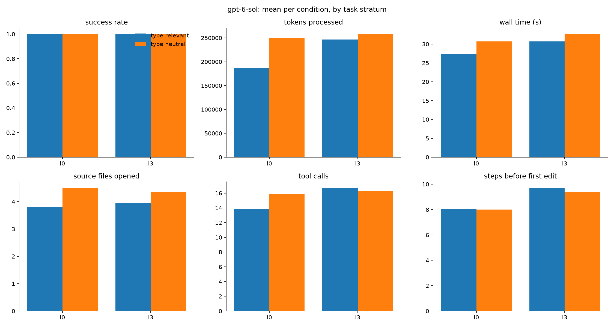

# Results: mutants-codex

80 finished runs, 20 tasks, conditions: l0, l3

## Comparisons (declared in DESIGN.md before running)

Each cell: paired-by-task estimate [95% bootstrap interval], sign-flip p-value, and in brackets the p-value Holm-adjusted across the metrics of that comparison (DESIGN.md section 9). Success rate and score are differences in proportion (+0.10 = 10 points better); the other metrics are ratios (x0.80 = 20% less).

| metric | R3: l3 vs l0 | R3-control: l3 vs l0 |
|---|---|---|
| success rate | +0.00 [+0.00, +0.00] p=1.000 (Holm 1.000) | +0.00 [+0.00, +0.00] p=1.000 (Holm 1.000) |
| score (partial credit) | +0.00 [+0.00, +0.00] p=1.000 (Holm 1.000) | +0.00 [+0.00, +0.00] p=1.000 (Holm 1.000) |
| wall time (s) | x1.11 [1.00, 1.23] p=0.097 (Holm 0.966) | x1.05 [0.94, 1.19] p=0.469 (Holm 1.000) |
| tokens processed | x1.29 [1.09, 1.55] p=0.013 (Holm 0.190) | x0.99 [0.86, 1.17] p=0.949 (Holm 1.000) |
| tokens without cache reads | x1.19 [1.03, 1.39] p=0.067 (Holm 0.784) | x0.96 [0.84, 1.09] p=0.592 (Holm 1.000) |
| API-equivalent cost ($) | n/a | n/a |
| model turns | x1.19 [1.03, 1.35] p=0.046 (Holm 0.642) | x1.03 [0.85, 1.24] p=0.776 (Holm 1.000) |
| tool calls | x1.20 [1.02, 1.38] p=0.054 (Holm 0.698) | x1.02 [0.81, 1.27] p=0.858 (Holm 1.000) |
| source files opened | x1.04 [0.93, 1.16] p=0.532 (Holm 1.000) | x0.98 [0.86, 1.13] p=0.783 (Holm 1.000) |
| characters read from files | x1.13 [0.89, 1.44] p=0.358 (Holm 1.000) | x1.01 [0.84, 1.21] p=0.969 (Holm 1.000) |
| searches (grep/glob/ls) | x1.01 [0.75, 1.32] p=1.000 (Holm 1.000) | x1.19 [0.99, 1.42] p=0.126 (Holm 1.000) |
| edit actions | x1.27 [1.07, 1.57] p=0.126 (Holm 1.000) | x0.90 [0.70, 1.13] p=0.508 (Holm 1.000) |
| test runs | +0.50 [+0.10, +0.95] p=0.126 (Holm 1.000) | +0.00 [-0.50, +0.50] p=1.000 (Holm 1.000) |
| type-checker runs | +0.00 [+0.00, +0.00] p=1.000 (Holm 1.000) | +0.00 [+0.00, +0.00] p=1.000 (Holm 1.000) |
| linter runs | +0.00 [+0.00, +0.00] p=1.000 (Holm 1.000) | +0.00 [+0.00, +0.00] p=1.000 (Holm 1.000) |
| steps before first edit | x1.20 [1.03, 1.42] p=0.065 (Holm 0.784) | x1.17 [0.89, 1.50] p=0.278 (Holm 1.000) |

- **R3**: Do types help on random bugs? (where they should) (l3 vs l0; tasks: `stratum == 'type_relevant'`)
- **R3-control**: ...and where they shouldn't (l3 vs l0; tasks: `stratum == 'type_neutral'`)

## Per condition (success: mean; costs: median)

| condition   |   runs |   passed |   score |   wall_s |   total_tokens |   uncached_tokens |   cost_usd |   turns |   tool_calls |   unique_files_read |   read_chars |   searches |   edits |   test_runs |   typecheck_runs |   lint_runs |   steps_before_first_edit |
|:------------|-------:|---------:|--------:|---------:|---------------:|------------------:|-----------:|--------:|-------------:|--------------------:|-------------:|-----------:|--------:|------------:|-----------------:|------------:|--------------------------:|
| l0          |     40 |        1 |       1 |    27.4  |         211820 |             18543 |        nan |    17   |           14 |                   4 |        22876 |          3 |       1 |        1.25 |                0 |           0 |                         7 |
| l3          |     40 |        1 |       1 |    30.35 |         242650 |             19260 |        nan |    20.5 |           17 |                   4 |        24540 |          3 |       1 |        1.5  |                0 |           0 |                        10 |

## Success rate by stratum and category

|                             |   l0 |   l3 |
|:----------------------------|-----:|-----:|
| ('type_neutral', 'bugfix')  |    1 |    1 |
| ('type_relevant', 'bugfix') |    1 |    1 |

## Success rate by task

|                                                        |   l0 |   l3 |
|:-------------------------------------------------------|-----:|-----:|
| ('type_neutral', 'mut08_payments_remove_call')         |    1 |    1 |
| ('type_neutral', 'mut26_dunning_remove_call')          |    1 |    1 |
| ('type_neutral', 'mut31_discounts_compare_boundary')   |    1 |    1 |
| ('type_neutral', 'mut41_payments_remove_call')         |    1 |    1 |
| ('type_neutral', 'mut45_reports_arith_swap')           |    1 |    1 |
| ('type_neutral', 'mut51_usage_compare_boundary')       |    1 |    1 |
| ('type_neutral', 'mut52_subscriptions_remove_call')    |    1 |    1 |
| ('type_neutral', 'mut55_render_remove_call')           |    1 |    1 |
| ('type_neutral', 'mut63_dunning_compare_boundary')     |    1 |    1 |
| ('type_neutral', 'mut66_dunning_remove_call')          |    1 |    1 |
| ('type_relevant', 'mut02_usage_drop_conversion')       |    1 |    1 |
| ('type_relevant', 'mut06_engine_swap_args')            |    1 |    1 |
| ('type_relevant', 'mut07_dunning_wrong_key')           |    1 |    1 |
| ('type_relevant', 'mut23_invoices_bool_swap')          |    1 |    1 |
| ('type_relevant', 'mut33_refunds_swap_args')           |    1 |    1 |
| ('type_relevant', 'mut47_render_swap_args')            |    1 |    1 |
| ('type_relevant', 'mut49_discounts_negate_none_check') |    1 |    1 |
| ('type_relevant', 'mut57_engine_bool_swap')            |    1 |    1 |
| ('type_relevant', 'mut68_reports_wrong_key')           |    1 |    1 |
| ('type_relevant', 'mut69_refunds_wrong_key')           |    1 |    1 |

## Median tokens by task

|                                                        |     l0 |     l3 |
|:-------------------------------------------------------|-------:|-------:|
| ('type_neutral', 'mut08_payments_remove_call')         | 221138 | 387806 |
| ('type_neutral', 'mut26_dunning_remove_call')          | 253334 | 201200 |
| ('type_neutral', 'mut31_discounts_compare_boundary')   | 177322 | 151432 |
| ('type_neutral', 'mut41_payments_remove_call')         | 291485 | 265159 |
| ('type_neutral', 'mut45_reports_arith_swap')           | 165134 | 162996 |
| ('type_neutral', 'mut51_usage_compare_boundary')       | 284876 | 205720 |
| ('type_neutral', 'mut52_subscriptions_remove_call')    | 347256 | 300754 |
| ('type_neutral', 'mut55_render_remove_call')           | 282252 | 345360 |
| ('type_neutral', 'mut63_dunning_compare_boundary')     | 270368 | 379740 |
| ('type_neutral', 'mut66_dunning_remove_call')          | 208210 | 179500 |
| ('type_relevant', 'mut02_usage_drop_conversion')       | 200258 | 247467 |
| ('type_relevant', 'mut06_engine_swap_args')            | 171896 | 328031 |
| ('type_relevant', 'mut07_dunning_wrong_key')           | 190230 | 250844 |
| ('type_relevant', 'mut23_invoices_bool_swap')          | 171205 | 143182 |
| ('type_relevant', 'mut33_refunds_swap_args')           | 153604 | 173946 |
| ('type_relevant', 'mut47_render_swap_args')            | 203924 | 213378 |
| ('type_relevant', 'mut49_discounts_negate_none_check') | 142064 | 347932 |
| ('type_relevant', 'mut57_engine_bool_swap')            | 264290 | 334050 |
| ('type_relevant', 'mut68_reports_wrong_key')           | 239308 | 274360 |
| ('type_relevant', 'mut69_refunds_wrong_key')           | 134892 | 154157 |

## Charts

