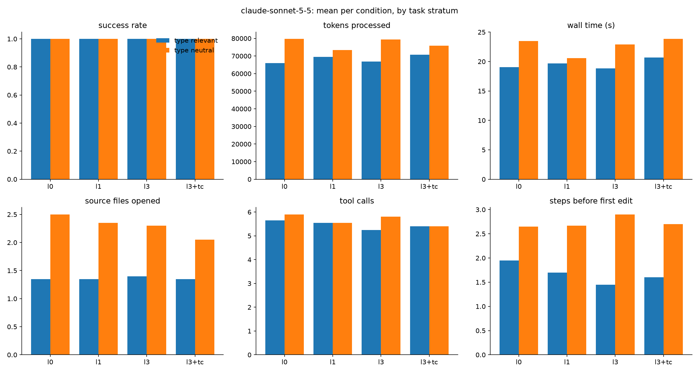

# Results: mutants

160 finished runs, 20 tasks, conditions: l0, l1, l3, l3+tc

## Comparisons (declared in DESIGN.md before running)

Each cell: paired-by-task estimate [95% bootstrap interval], sign-flip p-value, and in brackets the p-value Holm-adjusted across the metrics of that comparison (DESIGN.md section 9). Success rate and score are differences in proportion (+0.10 = 10 points better); the other metrics are ratios (x0.80 = 20% less).

| metric | R3: l3 vs l0 | R3-control: l3 vs l0 | R4a: l1 vs l0 | R4b: l3 vs l1 | R5: l3+tc vs l3 |
|---|---|---|---|---|---|
| success rate | +0.00 [+0.00, +0.00] p=1.000 (Holm 1.000) | +0.00 [+0.00, +0.00] p=1.000 (Holm 1.000) | +0.00 [+0.00, +0.00] p=1.000 (Holm 1.000) | +0.00 [+0.00, +0.00] p=1.000 (Holm 1.000) | +0.00 [+0.00, +0.00] p=1.000 (Holm 1.000) |
| score (partial credit) | +0.00 [+0.00, +0.00] p=1.000 (Holm 1.000) | +0.00 [+0.00, +0.00] p=1.000 (Holm 1.000) | +0.00 [+0.00, +0.00] p=1.000 (Holm 1.000) | +0.00 [+0.00, +0.00] p=1.000 (Holm 1.000) | +0.00 [+0.00, +0.00] p=1.000 (Holm 1.000) |
| wall time (s) | x1.03 [0.90, 1.16] p=0.709 (Holm 1.000) | x0.99 [0.85, 1.14] p=0.860 (Holm 1.000) | x0.94 [0.82, 1.09] p=0.455 (Holm 1.000) | x1.07 [0.92, 1.24] p=0.409 (Holm 1.000) | x1.17 [0.99, 1.38] p=0.089 (Holm 1.000) |
| tokens processed | x1.05 [0.86, 1.26] p=0.645 (Holm 1.000) | x1.01 [0.88, 1.15] p=0.897 (Holm 1.000) | x1.00 [0.90, 1.13] p=0.949 (Holm 1.000) | x1.03 [0.92, 1.14] p=0.648 (Holm 1.000) | x1.09 [0.93, 1.33] p=0.447 (Holm 1.000) |
| tokens without cache reads | x0.97 [0.83, 1.14] p=0.705 (Holm 1.000) | x0.87 [0.79, 0.96] p=0.034 (Holm 0.546) | x0.96 [0.85, 1.09] p=0.544 (Holm 1.000) | x0.95 [0.88, 1.04] p=0.312 (Holm 1.000) | x1.16 [1.06, 1.29] p=0.012 (Holm 0.187) |
| API-equivalent cost ($) | x1.05 [0.95, 1.15] p=0.393 (Holm 1.000) | x1.00 [0.94, 1.07] p=0.918 (Holm 1.000) | x1.01 [0.95, 1.08] p=0.688 (Holm 1.000) | x1.01 [0.95, 1.08] p=0.739 (Holm 1.000) | x1.09 [0.99, 1.19] p=0.152 (Holm 1.000) |
| model turns | x0.96 [0.82, 1.12] p=0.684 (Holm 1.000) | x0.99 [0.85, 1.14] p=0.881 (Holm 1.000) | x0.98 [0.89, 1.09] p=0.737 (Holm 1.000) | x0.99 [0.91, 1.09] p=0.898 (Holm 1.000) | x1.09 [0.97, 1.22] p=0.222 (Holm 1.000) |
| tool calls | x0.96 [0.80, 1.15] p=0.723 (Holm 1.000) | x0.99 [0.83, 1.17] p=0.897 (Holm 1.000) | x0.98 [0.87, 1.12] p=0.793 (Holm 1.000) | x0.99 [0.89, 1.10] p=0.884 (Holm 1.000) | x1.09 [0.95, 1.26] p=0.300 (Holm 1.000) |
| source files opened | x1.03 [0.79, 1.31] p=1.000 (Holm 1.000) | x0.84 [0.69, 1.00] p=0.126 (Holm 1.000) | x0.91 [0.76, 1.05] p=0.393 (Holm 1.000) | x1.01 [0.88, 1.16] p=0.892 (Holm 1.000) | x1.04 [0.88, 1.22] p=0.752 (Holm 1.000) |
| characters read from files | x1.23 [0.95, 1.56] p=0.165 (Holm 1.000) | x1.14 [0.93, 1.39] p=0.270 (Holm 1.000) | x1.11 [0.98, 1.28] p=0.142 (Holm 1.000) | x1.06 [0.88, 1.25] p=0.538 (Holm 1.000) | x1.04 [0.74, 1.49] p=0.813 (Holm 1.000) |
| searches (grep/glob/ls) | x1.00 [nan, nan] p=1.000 (Holm 1.000) | x1.00 [nan, nan] p=1.000 (Holm 1.000) | x0.96 [0.72, 1.23] p=1.000 (Holm 1.000) | x1.00 [1.00, 1.00] p=1.000 (Holm 1.000) | x1.00 [nan, nan] p=1.000 (Holm 1.000) |
| edit actions | x1.02 [0.88, 1.16] p=0.899 (Holm 1.000) | x0.89 [0.73, 1.08] p=0.313 (Holm 1.000) | x0.94 [0.83, 1.06] p=0.394 (Holm 1.000) | x1.00 [0.90, 1.15] p=0.998 (Holm 1.000) | x1.02 [0.87, 1.20] p=1.000 (Holm 1.000) |
| test runs | +0.45 [+0.10, +0.80] p=0.079 (Holm 1.000) | +0.25 [-0.30, +0.75] p=0.485 (Holm 1.000) | +0.03 [-0.33, +0.38] p=1.000 (Holm 1.000) | +0.33 [-0.05, +0.72] p=0.155 (Holm 1.000) | +0.00 [-0.56, +0.56] p=1.000 (Holm 1.000) |
| type-checker runs | +0.00 [+0.00, +0.00] p=1.000 (Holm 1.000) | +0.00 [+0.00, +0.00] p=1.000 (Holm 1.000) | +0.00 [+0.00, +0.00] p=1.000 (Holm 1.000) | +0.00 [+0.00, +0.00] p=1.000 (Holm 1.000) | +1.31 [+0.81, +1.81] p=0.019 (Holm 0.292) |
| linter runs | +0.00 [+0.00, +0.00] p=1.000 (Holm 1.000) | +0.00 [+0.00, +0.00] p=1.000 (Holm 1.000) | +0.00 [+0.00, +0.00] p=1.000 (Holm 1.000) | +0.00 [+0.00, +0.00] p=1.000 (Holm 1.000) | +0.00 [+0.00, +0.00] p=1.000 (Holm 1.000) |
| steps before first edit | x0.79 [0.54, 1.10] p=0.313 (Holm 1.000) | x1.12 [0.90, 1.39] p=0.372 (Holm 1.000) | x0.95 [0.81, 1.11] p=0.550 (Holm 1.000) | x0.98 [0.81, 1.21] p=0.866 (Holm 1.000) | x1.17 [0.94, 1.57] p=0.440 (Holm 1.000) |

- **R3**: Do types help on random bugs? (where they should) (l3 vs l0; tasks: `stratum == 'type_relevant'`)
- **R3-control**: ...and where they shouldn't (l3 vs l0; tasks: `stratum == 'type_neutral'`)
- **R4a**: Partial typing against none (l1 vs l0; tasks: `task == task`)
- **R4b**: Full typing against partial (l3 vs l1; tasks: `task == task`)
- **R5**: Type checker on bugs mypy catches (l3+tc vs l3; tasks: `checker_catches_at in ['l2', 'l3']`)

## Per condition (success: mean; costs: median)

| condition   |   runs |   passed |   score |   wall_s |   total_tokens |   uncached_tokens |   cost_usd |   turns |   tool_calls |   unique_files_read |   read_chars |   searches |   edits |   test_runs |   typecheck_runs |   lint_runs |   steps_before_first_edit |
|:------------|-------:|---------:|--------:|---------:|---------------:|------------------:|-----------:|--------:|-------------:|--------------------:|-------------:|-----------:|--------:|------------:|-----------------:|------------:|--------------------------:|
| l0          |     40 |        1 |       1 |    19.75 |        66963   |            1436.5 |      0.052 |     6.5 |          5.5 |                 2   |       7537.5 |          0 |       3 |       1.075 |             0    |           0 |                       2.5 |
| l1          |     40 |        1 |       1 |    17.7  |        65377   |            1245.5 |      0.049 |     6   |          5   |                 2   |       7256   |          0 |       2 |       1.1   |             0    |           0 |                       2   |
| l3          |     40 |        1 |       1 |    20.7  |        67698   |            1139.5 |      0.052 |     6   |          5   |                 2   |       7294.5 |          0 |       2 |       1.425 |             0    |           0 |                       2   |
| l3+tc       |     40 |        1 |       1 |    21.45 |        69093.5 |            1265.5 |      0.056 |     6   |          5   |                 1.5 |       8067.5 |          0 |       2 |       1.2   |             1.05 |           0 |                       2   |

## Success rate by stratum and category

|                             |   l0 |   l1 |   l3 |   l3+tc |
|:----------------------------|-----:|-----:|-----:|--------:|
| ('type_neutral', 'bugfix')  |    1 |    1 |    1 |       1 |
| ('type_relevant', 'bugfix') |    1 |    1 |    1 |       1 |

## Success rate by task

|                                                        |   l0 |   l1 |   l3 |   l3+tc |
|:-------------------------------------------------------|-----:|-----:|-----:|--------:|
| ('type_neutral', 'mut08_payments_remove_call')         |    1 |    1 |    1 |       1 |
| ('type_neutral', 'mut26_dunning_remove_call')          |    1 |    1 |    1 |       1 |
| ('type_neutral', 'mut31_discounts_compare_boundary')   |    1 |    1 |    1 |       1 |
| ('type_neutral', 'mut41_payments_remove_call')         |    1 |    1 |    1 |       1 |
| ('type_neutral', 'mut45_reports_arith_swap')           |    1 |    1 |    1 |       1 |
| ('type_neutral', 'mut51_usage_compare_boundary')       |    1 |    1 |    1 |       1 |
| ('type_neutral', 'mut52_subscriptions_remove_call')    |    1 |    1 |    1 |       1 |
| ('type_neutral', 'mut55_render_remove_call')           |    1 |    1 |    1 |       1 |
| ('type_neutral', 'mut63_dunning_compare_boundary')     |    1 |    1 |    1 |       1 |
| ('type_neutral', 'mut66_dunning_remove_call')          |    1 |    1 |    1 |       1 |
| ('type_relevant', 'mut02_usage_drop_conversion')       |    1 |    1 |    1 |       1 |
| ('type_relevant', 'mut06_engine_swap_args')            |    1 |    1 |    1 |       1 |
| ('type_relevant', 'mut07_dunning_wrong_key')           |    1 |    1 |    1 |       1 |
| ('type_relevant', 'mut23_invoices_bool_swap')          |    1 |    1 |    1 |       1 |
| ('type_relevant', 'mut33_refunds_swap_args')           |    1 |    1 |    1 |       1 |
| ('type_relevant', 'mut47_render_swap_args')            |    1 |    1 |    1 |       1 |
| ('type_relevant', 'mut49_discounts_negate_none_check') |    1 |    1 |    1 |       1 |
| ('type_relevant', 'mut57_engine_bool_swap')            |    1 |    1 |    1 |       1 |
| ('type_relevant', 'mut68_reports_wrong_key')           |    1 |    1 |    1 |       1 |
| ('type_relevant', 'mut69_refunds_wrong_key')           |    1 |    1 |    1 |       1 |

## Median tokens by task

|                                                        |     l0 |     l1 |     l3 |   l3+tc |
|:-------------------------------------------------------|-------:|-------:|-------:|--------:|
| ('type_neutral', 'mut08_payments_remove_call')         |  92490 |  70714 |  68584 |   58356 |
| ('type_neutral', 'mut26_dunning_remove_call')          |  62055 |  88090 |  53466 |   63510 |
| ('type_neutral', 'mut31_discounts_compare_boundary')   |  58890 |  66850 |  76889 |   68637 |
| ('type_neutral', 'mut41_payments_remove_call')         |  78836 |  98694 |  97688 |   95879 |
| ('type_neutral', 'mut45_reports_arith_swap')           |  85227 |  55098 |  85830 |   93730 |
| ('type_neutral', 'mut51_usage_compare_boundary')       |  68398 |  61168 |  89126 |   61296 |
| ('type_neutral', 'mut52_subscriptions_remove_call')    | 108094 |  92992 |  82468 |   94614 |
| ('type_neutral', 'mut55_render_remove_call')           |  52760 |  47502 |  46494 |   40870 |
| ('type_neutral', 'mut63_dunning_compare_boundary')     | 116486 |  94084 |  99598 |  113329 |
| ('type_neutral', 'mut66_dunning_remove_call')          |  73984 |  59456 |  94223 |   68701 |
| ('type_relevant', 'mut02_usage_drop_conversion')       |  62950 |  60296 |  60378 |   39884 |
| ('type_relevant', 'mut06_engine_swap_args')            |  71142 |  73356 |  72306 |   84840 |
| ('type_relevant', 'mut07_dunning_wrong_key')           |  67368 |  71497 |  62126 |   68525 |
| ('type_relevant', 'mut23_invoices_bool_swap')          |  55195 |  49104 |  63236 |   58494 |
| ('type_relevant', 'mut33_refunds_swap_args')           | 111889 |  96176 |  60801 |  118177 |
| ('type_relevant', 'mut47_render_swap_args')            |  34009 |  59844 |  54730 |   56235 |
| ('type_relevant', 'mut49_discounts_negate_none_check') |  74804 |  53964 |  55094 |   70540 |
| ('type_relevant', 'mut57_engine_bool_swap')            |  85335 | 106606 | 114904 |  101930 |
| ('type_relevant', 'mut68_reports_wrong_key')           |  48801 |  69906 |  64736 |   57328 |
| ('type_relevant', 'mut69_refunds_wrong_key')           |  47747 |  54192 |  60884 |   51459 |

## Charts

