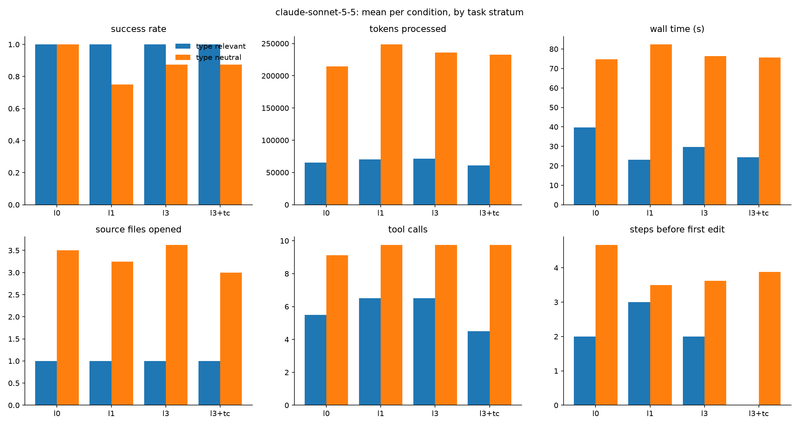

# Results: vunnel (claude-sonnet)

40 finished runs, 5 tasks, conditions: l0, l1, l3, l3+tc

## Comparisons (declared in DESIGN.md before running)

Each cell: paired-by-task estimate [95% bootstrap interval], sign-flip p-value, and in brackets the p-value Holm-adjusted across the metrics of that comparison (DESIGN.md section 9). Success rate and score are differences in proportion (+0.10 = 10 points better); the other metrics are ratios (x0.80 = 20% less).

| metric | R6: l3 vs l0 | R6-tc: l3+tc vs l3 | R4a: l1 vs l0 | R4b: l3 vs l1 |
|---|---|---|---|---|
| success rate | -0.10 [-0.30, +0.00] p=1.000 (Holm 1.000) | +0.00 [-0.30, +0.30] p=1.000 (Holm 1.000) | -0.20 [-0.60, +0.00] p=1.000 (Holm 1.000) | +0.10 [+0.00, +0.30] p=1.000 (Holm 1.000) |
| score (partial credit) | -0.01 [-0.03, +0.00] p=1.000 (Holm 1.000) | -0.02 [-0.10, +0.03] p=1.000 (Holm 1.000) | -0.02 [-0.06, +0.00] p=1.000 (Holm 1.000) | +0.01 [+0.00, +0.03] p=1.000 (Holm 1.000) |
| wall time (s) | x0.90 [0.64, 1.27] p=0.636 (Holm 1.000) | x1.00 [0.82, 1.16] p=0.879 (Holm 1.000) | x0.94 [0.66, 1.36] p=0.818 (Holm 1.000) | x0.95 [0.84, 1.08] p=0.455 (Holm 1.000) |
| tokens processed | x1.07 [0.97, 1.19] p=0.394 (Holm 1.000) | x0.96 [0.85, 1.10] p=0.636 (Holm 1.000) | x1.17 [1.01, 1.35] p=0.212 (Holm 1.000) | x0.92 [0.80, 1.08] p=0.455 (Holm 1.000) |
| tokens without cache reads | x1.06 [0.98, 1.17] p=0.394 (Holm 1.000) | x0.97 [0.89, 1.05] p=0.576 (Holm 1.000) | x1.11 [0.94, 1.32] p=0.394 (Holm 1.000) | x0.96 [0.86, 1.08] p=0.576 (Holm 1.000) |
| API-equivalent cost ($) | x1.03 [0.96, 1.09] p=0.515 (Holm 1.000) | x0.97 [0.91, 1.04] p=0.515 (Holm 1.000) | x1.10 [0.97, 1.30] p=0.455 (Holm 1.000) | x0.94 [0.81, 1.08] p=0.515 (Holm 1.000) |
| model turns | x1.04 [0.90, 1.23] p=0.758 (Holm 1.000) | x0.95 [0.82, 1.11] p=0.758 (Holm 1.000) | x1.09 [1.00, 1.17] p=0.212 (Holm 1.000) | x0.95 [0.79, 1.12] p=0.758 (Holm 1.000) |
| tool calls | x1.04 [0.88, 1.25] p=0.758 (Holm 1.000) | x0.94 [0.78, 1.12] p=0.758 (Holm 1.000) | x1.11 [1.00, 1.21] p=0.212 (Holm 1.000) | x0.94 [0.76, 1.13] p=0.758 (Holm 1.000) |
| source files opened | x1.05 [1.00, 1.11] p=0.515 (Holm 1.000) | x0.86 [0.76, 0.97] p=0.273 (Holm 1.000) | x0.96 [0.83, 1.07] p=1.000 (Holm 1.000) | x1.10 [1.00, 1.24] p=0.515 (Holm 1.000) |
| characters read from files | x0.85 [0.59, 1.08] p=0.576 (Holm 1.000) | x1.08 [0.89, 1.32] p=0.515 (Holm 1.000) | x0.90 [0.77, 1.03] p=0.333 (Holm 1.000) | x0.94 [0.76, 1.15] p=0.697 (Holm 1.000) |
| searches (grep/glob/ls) | n/a | n/a | n/a | x1.00 [nan, nan] p=1.000 (Holm 1.000) |
| edit actions | x1.29 [0.85, 1.74] p=0.412 (Holm 1.000) | x1.11 [0.65, 1.96] p=0.765 (Holm 1.000) | x1.21 [1.00, 1.76] p=1.000 (Holm 1.000) | x0.95 [0.68, 1.32] p=0.818 (Holm 1.000) |
| test runs | +0.60 [+0.00, +1.60] p=0.515 (Holm 1.000) | -0.90 [-1.70, -0.30] p=0.152 (Holm 1.000) | +0.40 [-0.40, +1.00] p=0.636 (Holm 1.000) | +0.20 [-0.80, +1.20] p=0.758 (Holm 1.000) |
| type-checker runs | +0.00 [+0.00, +0.00] p=1.000 (Holm 1.000) | +0.90 [+0.40, +1.30] p=0.152 (Holm 1.000) | +0.00 [+0.00, +0.00] p=1.000 (Holm 1.000) | +0.00 [+0.00, +0.00] p=1.000 (Holm 1.000) |
| linter runs | +0.00 [+0.00, +0.00] p=1.000 (Holm 1.000) | +0.00 [+0.00, +0.00] p=1.000 (Holm 1.000) | +0.00 [+0.00, +0.00] p=1.000 (Holm 1.000) | +0.00 [+0.00, +0.00] p=1.000 (Holm 1.000) |
| steps before first edit | x0.80 [0.63, 1.02] p=0.529 (Holm 1.000) | x1.05 [1.00, 1.11] p=0.529 (Holm 1.000) | x0.91 [0.66, 1.24] p=0.765 (Holm 1.000) | x0.95 [0.78, 1.14] p=0.758 (Holm 1.000) |

- **R6**: Types on a real codebase (l3 vs l0; tasks: `task == task`)
- **R6-tc**: Type checker on a real codebase (l3+tc vs l3; tasks: `task == task`)
- **R4a**: Partial typing against none (l1 vs l0; tasks: `task == task`)
- **R4b**: Full typing against partial (l3 vs l1; tasks: `task == task`)

## Per condition (success: mean; costs: median)

| condition   |   runs |   passed |   score |   wall_s |   total_tokens |   uncached_tokens |   cost_usd |   turns |   tool_calls |   unique_files_read |   read_chars |   searches |   edits |   test_runs |   typecheck_runs |   lint_runs |   steps_before_first_edit |
|:------------|-------:|---------:|--------:|---------:|---------------:|------------------:|-----------:|--------:|-------------:|--------------------:|-------------:|-----------:|--------:|------------:|-----------------:|------------:|--------------------------:|
| l0          |     10 |      1   |   1     |    80.45 |         200584 |            4229   |      0.146 |    10   |          9   |                 3.5 |      25525   |          0 |     1.5 |         2.6 |              0   |           0 |                       2.5 |
| l1          |     10 |      0.8 |   0.98  |    68.3  |         232786 |            5166.5 |      0.161 |    10.5 |          9.5 |                 3.5 |      22029.5 |          0 |     2   |         3   |              0   |           0 |                       3.5 |
| l3          |     10 |      0.9 |   0.99  |    66.6  |         207767 |            4488   |      0.152 |    10   |          9   |                 4   |      28545.5 |          0 |     1.5 |         3.2 |              0   |           0 |                       4   |
| l3+tc       |     10 |      0.9 |   0.967 |    64.9  |         216205 |            4779   |      0.15  |    11   |         10   |                 3   |      25354.5 |          0 |     1.5 |         2.3 |              0.9 |           0 |                       4   |

## Success rate by stratum and category

|                             |   l0 |   l1 |   l3 |   l3+tc |
|:----------------------------|-----:|-----:|-----:|--------:|
| ('type_neutral', 'bugfix')  |    1 |    1 |    1 |     0.5 |
| ('type_relevant', 'bugfix') |    1 |    1 |    1 |     1   |

## Success rate by task

|                                         |   l0 |   l1 |   l3 |   l3+tc |
|:----------------------------------------|-----:|-----:|-----:|--------:|
| ('type_neutral', 'vunnel_h01_3ef864b')  |    1 |    0 |  0.5 |     1   |
| ('type_neutral', 'vunnel_h04_195fe1e')  |    1 |    1 |  1   |     0.5 |
| ('type_neutral', 'vunnel_h13_cac6eb4')  |    1 |    1 |  1   |     1   |
| ('type_neutral', 'vunnel_h14_a0442ca')  |    1 |    1 |  1   |     1   |
| ('type_relevant', 'vunnel_h07_5cdd0c0') |    1 |    1 |  1   |     1   |

## Median tokens by task

|                                         |     l0 |     l1 |     l3 |   l3+tc |
|:----------------------------------------|-------:|-------:|-------:|--------:|
| ('type_neutral', 'vunnel_h01_3ef864b')  | 200584 | 294720 | 284436 |  216856 |
| ('type_neutral', 'vunnel_h04_195fe1e')  | 258205 | 232786 | 280087 |  249228 |
| ('type_neutral', 'vunnel_h13_cac6eb4')  |  56172 |  76682 |  54802 |   55581 |
| ('type_neutral', 'vunnel_h14_a0442ca')  | 342289 | 390322 | 325694 |  409061 |
| ('type_relevant', 'vunnel_h07_5cdd0c0') |  65449 |  70562 |  71646 |   60686 |

## Charts

