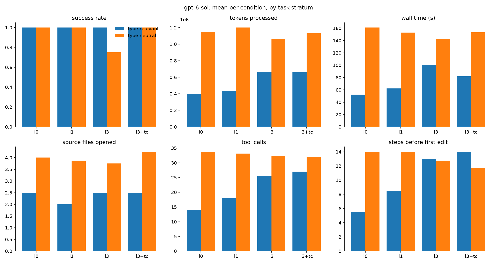

# Results: vunnel (codex)

40 finished runs, 5 tasks, conditions: l0, l1, l3, l3+tc

## Comparisons (declared in DESIGN.md before running)

Each cell: paired-by-task estimate [95% bootstrap interval], sign-flip p-value, and in brackets the p-value Holm-adjusted across the metrics of that comparison (DESIGN.md section 9). Success rate and score are differences in proportion (+0.10 = 10 points better); the other metrics are ratios (x0.80 = 20% less).

| metric | R6: l3 vs l0 | R6-tc: l3+tc vs l3 | R4a: l1 vs l0 | R4b: l3 vs l1 |
|---|---|---|---|---|
| success rate | -0.20 [-0.60, +0.00] p=1.000 (Holm 1.000) | +0.20 [+0.00, +0.60] p=1.000 (Holm 1.000) | +0.00 [+0.00, +0.00] p=1.000 (Holm 1.000) | -0.20 [-0.60, +0.00] p=1.000 (Holm 1.000) |
| score (partial credit) | -0.06 [-0.18, +0.00] p=1.000 (Holm 1.000) | +0.06 [+0.00, +0.18] p=1.000 (Holm 1.000) | +0.00 [+0.00, +0.00] p=1.000 (Holm 1.000) | -0.06 [-0.18, +0.00] p=1.000 (Holm 1.000) |
| wall time (s) | x1.04 [0.80, 1.44] p=0.879 (Holm 1.000) | x1.00 [0.86, 1.18] p=1.000 (Holm 1.000) | x1.01 [0.87, 1.20] p=0.939 (Holm 1.000) | x1.03 [0.74, 1.38] p=0.939 (Holm 1.000) |
| tokens processed | x1.05 [0.80, 1.37] p=0.818 (Holm 1.000) | x1.01 [0.84, 1.14] p=0.939 (Holm 1.000) | x1.06 [0.90, 1.23] p=0.576 (Holm 1.000) | x0.99 [0.70, 1.39] p=1.000 (Holm 1.000) |
| tokens without cache reads | x1.10 [0.92, 1.35] p=0.636 (Holm 1.000) | x1.00 [0.83, 1.18] p=1.000 (Holm 1.000) | x1.17 [1.03, 1.30] p=0.152 (Holm 1.000) | x0.93 [0.72, 1.21] p=0.697 (Holm 1.000) |
| API-equivalent cost ($) | n/a | n/a | n/a | n/a |
| model turns | x1.09 [0.84, 1.41] p=0.576 (Holm 1.000) | x0.99 [0.83, 1.17] p=1.000 (Holm 1.000) | x1.04 [0.92, 1.18] p=0.576 (Holm 1.000) | x1.05 [0.84, 1.31] p=0.697 (Holm 1.000) |
| tool calls | x1.11 [0.83, 1.48] p=0.576 (Holm 1.000) | x0.98 [0.80, 1.19] p=1.000 (Holm 1.000) | x1.04 [0.91, 1.20] p=0.636 (Holm 1.000) | x1.06 [0.82, 1.37] p=0.697 (Holm 1.000) |
| source files opened | x0.96 [0.86, 1.05] p=0.758 (Holm 1.000) | x1.12 [0.98, 1.28] p=0.273 (Holm 1.000) | x0.94 [0.87, 1.00] p=0.515 (Holm 1.000) | x1.02 [0.92, 1.14] p=0.879 (Holm 1.000) |
| characters read from files | x1.28 [0.91, 1.81] p=0.515 (Holm 1.000) | x0.88 [0.77, 0.99] p=0.273 (Holm 1.000) | x1.35 [0.90, 2.28] p=0.394 (Holm 1.000) | x0.94 [0.69, 1.29] p=0.879 (Holm 1.000) |
| searches (grep/glob/ls) | x1.45 [0.96, 2.52] p=0.273 (Holm 1.000) | x0.89 [0.54, 1.49] p=0.697 (Holm 1.000) | x0.83 [0.58, 1.18] p=0.394 (Holm 1.000) | x1.75 [1.38, 2.20] p=0.091 (Holm 1.000) |
| edit actions | x1.16 [0.74, 1.99] p=0.697 (Holm 1.000) | x0.92 [0.73, 1.15] p=0.636 (Holm 1.000) | x0.90 [0.72, 1.14] p=0.515 (Holm 1.000) | x1.30 [0.87, 1.94] p=0.394 (Holm 1.000) |
| test runs | +0.40 [-0.90, +2.10] p=0.879 (Holm 1.000) | -0.80 [-1.80, +0.20] p=0.394 (Holm 1.000) | +0.40 [-0.40, +1.30] p=0.636 (Holm 1.000) | +0.00 [-2.00, +2.10] p=1.000 (Holm 1.000) |
| type-checker runs | +0.00 [+0.00, +0.00] p=1.000 (Holm 1.000) | +1.80 [+1.20, +2.40] p=0.091 (Holm 1.000) | +0.00 [+0.00, +0.00] p=1.000 (Holm 1.000) | +0.00 [+0.00, +0.00] p=1.000 (Holm 1.000) |
| linter runs | +0.00 [+0.00, +0.00] p=1.000 (Holm 1.000) | +0.00 [+0.00, +0.00] p=1.000 (Holm 1.000) | +0.00 [+0.00, +0.00] p=1.000 (Holm 1.000) | +0.00 [+0.00, +0.00] p=1.000 (Holm 1.000) |
| steps before first edit | x1.16 [0.78, 1.75] p=0.576 (Holm 1.000) | x0.87 [0.57, 1.34] p=0.636 (Holm 1.000) | x1.13 [0.89, 1.44] p=0.455 (Holm 1.000) | x1.03 [0.75, 1.42] p=0.818 (Holm 1.000) |

- **R6**: Types on a real codebase (l3 vs l0; tasks: `task == task`)
- **R6-tc**: Type checker on a real codebase (l3+tc vs l3; tasks: `task == task`)
- **R4a**: Partial typing against none (l1 vs l0; tasks: `task == task`)
- **R4b**: Full typing against partial (l3 vs l1; tasks: `task == task`)

## Per condition (success: mean; costs: median)

| condition   |   runs |   passed |   score |   wall_s |   total_tokens |   uncached_tokens |   cost_usd |   turns |   tool_calls |   unique_files_read |   read_chars |   searches |   edits |   test_runs |   typecheck_runs |   lint_runs |   steps_before_first_edit |
|:------------|-------:|---------:|--------:|---------:|---------------:|------------------:|-----------:|--------:|-------------:|--------------------:|-------------:|-----------:|--------:|------------:|-----------------:|------------:|--------------------------:|
| l0          |     10 |      1   |    1    |   115.1  |         933922 |           52193   |        nan |    35.5 |         30.5 |                 4   |      67157.5 |        2   |     6   |         5.6 |              0   |           0 |                      10   |
| l1          |     10 |      1   |    1    |   141.75 |         916212 |           62580.5 |        nan |    34   |         28   |                 4   |      89559   |        2   |     4   |         6   |              0   |           0 |                      12.5 |
| l3          |     10 |      0.8 |    0.94 |   123.85 |         849165 |           57851.5 |        nan |    36   |         30.5 |                 3.5 |      66557.5 |        2.5 |     4.5 |         6   |              0   |           0 |                      13.5 |
| l3+tc       |     10 |      1   |    1    |   123.85 |         840384 |           61166.5 |        nan |    32.5 |         27   |                 4   |      57094.5 |        2.5 |     4   |         5.2 |              1.8 |           0 |                       9.5 |

## Success rate by stratum and category

|                             |   l0 |   l1 |   l3 |   l3+tc |
|:----------------------------|-----:|-----:|-----:|--------:|
| ('type_neutral', 'bugfix')  |    1 |    1 |    1 |       1 |
| ('type_relevant', 'bugfix') |    1 |    1 |    1 |       1 |

## Success rate by task

|                                         |   l0 |   l1 |   l3 |   l3+tc |
|:----------------------------------------|-----:|-----:|-----:|--------:|
| ('type_neutral', 'vunnel_h01_3ef864b')  |    1 |    1 |    0 |       1 |
| ('type_neutral', 'vunnel_h04_195fe1e')  |    1 |    1 |    1 |       1 |
| ('type_neutral', 'vunnel_h13_cac6eb4')  |    1 |    1 |    1 |       1 |
| ('type_neutral', 'vunnel_h14_a0442ca')  |    1 |    1 |    1 |       1 |
| ('type_relevant', 'vunnel_h07_5cdd0c0') |    1 |    1 |    1 |       1 |

## Median tokens by task

|                                         |               l0 |               l1 |               l3 |            l3+tc |
|:----------------------------------------|-----------------:|-----------------:|-----------------:|-----------------:|
| ('type_neutral', 'vunnel_h01_3ef864b')  |      1.1524e+06  | 916212           |      1.46176e+06 |      1.06505e+06 |
| ('type_neutral', 'vunnel_h04_195fe1e')  |      1.16396e+06 |      1.54897e+06 | 787162           | 891738           |
| ('type_neutral', 'vunnel_h13_cac6eb4')  | 630444           | 739542           | 664908           | 725328           |
| ('type_neutral', 'vunnel_h14_a0442ca')  |      1.64039e+06 |      1.5985e+06  |      1.33419e+06 |      1.84401e+06 |
| ('type_relevant', 'vunnel_h07_5cdd0c0') | 397906           | 432408           | 660116           | 659797           |

## Charts

